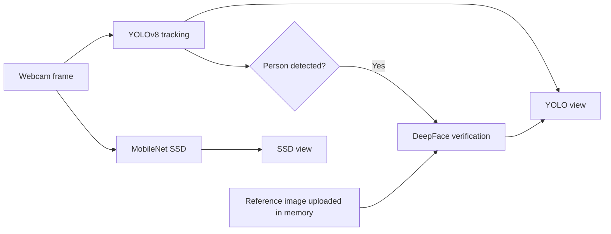

# Real-Time Object Detection & Face Verification

A local Streamlit computer-vision application that compares two real-time object-detection pipelines and verifies detected people against a user-supplied reference image.

The project combines **YOLOv8**, **MobileNet SSD**, **OpenCV DNN**, and **DeepFace** in a single webcam interface. It was modernized from an earlier individual project for portfolio use, with improved privacy, setup instructions, and per-person verification state.

## Features

- Real-time webcam inference with YOLOv8
- A parallel MobileNet SSD / OpenCV DNN detection view
- Face verification for people detected by YOLOv8
- Independent verification state for tracked people
- Configurable SSD confidence and face-verification intervals
- In-memory reference-image upload through Streamlit
- No personal image or biometric data included in the repository

## Architecture



## Privacy by design

The repository does **not** contain an owner photograph or any other face image. The reference image is selected by the person running the application, decoded in memory, and passed directly to DeepFace. The application does not write that image to the project directory.

This is a demonstration project, not a production biometric identification or security system. Use it only with the knowledge and consent of everyone appearing on camera.

## Requirements

- Python 3.10 or 3.11
- A local webcam
- Camera permission for Python
- Internet access during the initial model setup

## Installation

```bash
git clone https://github.com/Halezkn/real-time-object-detection-face-verification.git
cd real-time-object-detection-face-verification
python -m venv .venv
```

Activate the environment on Windows:

```powershell
.venv\Scripts\Activate.ps1
```

Install the dependencies and download the MobileNet SSD files:

```bash
python -m pip install -r requirements.txt
python download_models.py
```

Ultralytics downloads the small `yolov8n.pt` checkpoint automatically on the first run. Downloaded model files are excluded from Git.

## Run

```bash
streamlit run app.py
```

Then:

1. Upload a clear reference face image in the sidebar.
2. Adjust the confidence or verification interval if needed.
3. Turn on **Start camera**.

The left panel displays YOLOv8 detections and face-verification labels. The right panel displays MobileNet SSD detections.

## Project structure

```text
.
|-- app.py                 # Streamlit UI and both detection pipelines
|-- face_utils.py          # DeepFace verification helper
|-- download_models.py     # MobileNet SSD setup helper
|-- requirements.txt
|-- .gitignore
`-- README.md
```

## Technical notes

- YOLO tracking identifiers keep verification results separate when multiple people are visible.
- Verification is repeated at a configurable interval instead of on every frame.
- Face detection remains enabled during verification; a person crop without a detectable face is treated as unknown.
- MobileNet SSD uses the PASCAL VOC label set.

## Model acknowledgements

- [Ultralytics YOLO](https://github.com/ultralytics/ultralytics)
- [MobileNet SSD Caffe implementation](https://github.com/chuanqi305/MobileNet-SSD)
- [DeepFace](https://github.com/serengil/deepface)

## Limitations

- Face verification was generally consistent during local testing, although occasional short-lived mismatches were observed under less favorable viewing conditions.
- The MobileNet SSD pipeline uses the Caffe model format and requires OpenCV 4.x. The project pins `opencv-python==4.10.0.84` because Caffe model loading is no longer available in OpenCV 5.
